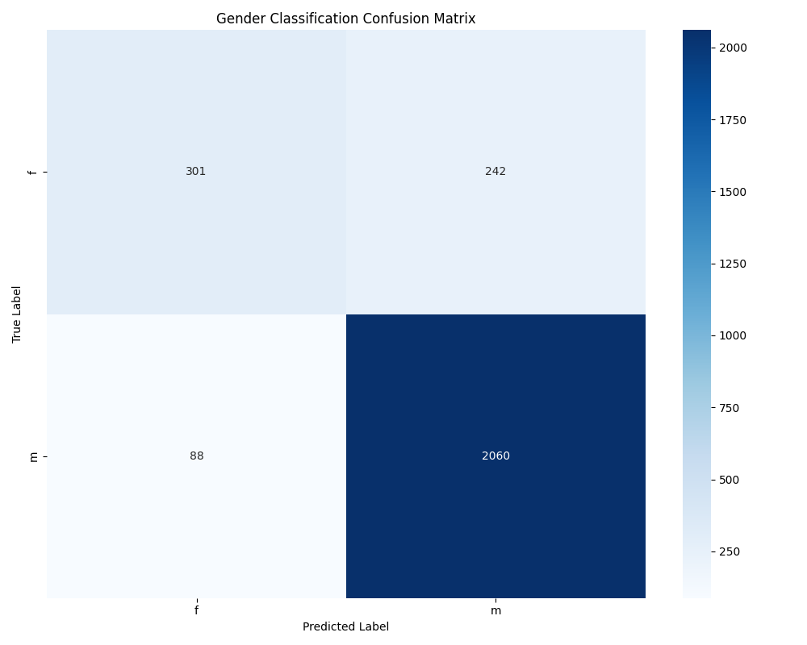
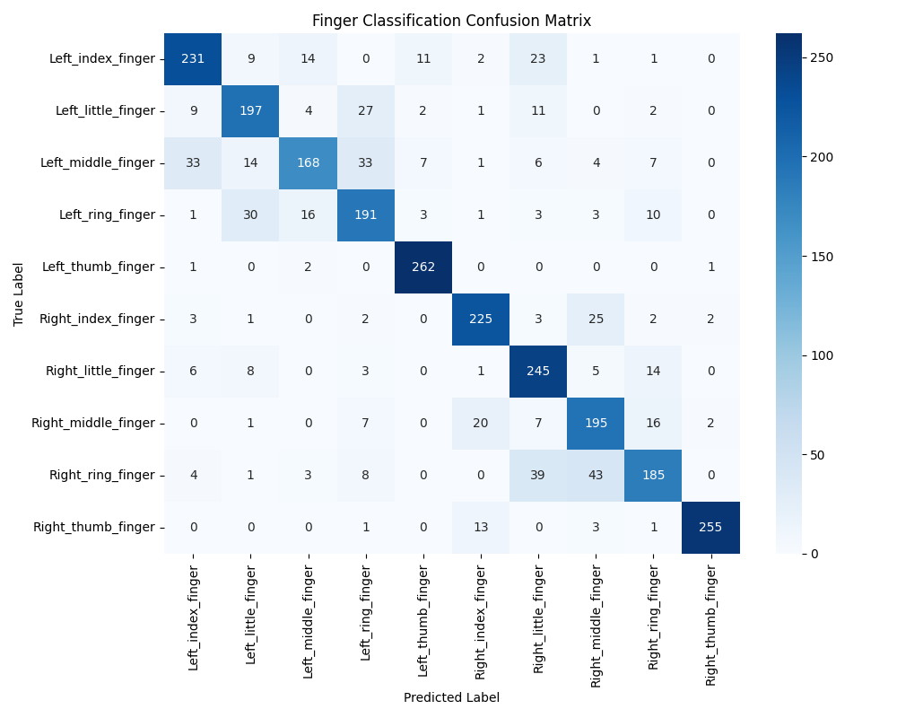
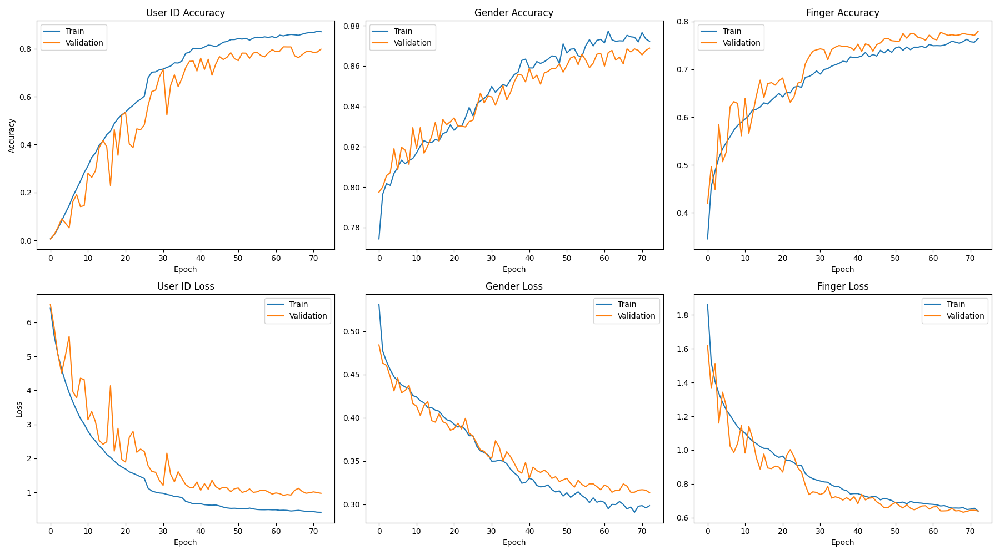
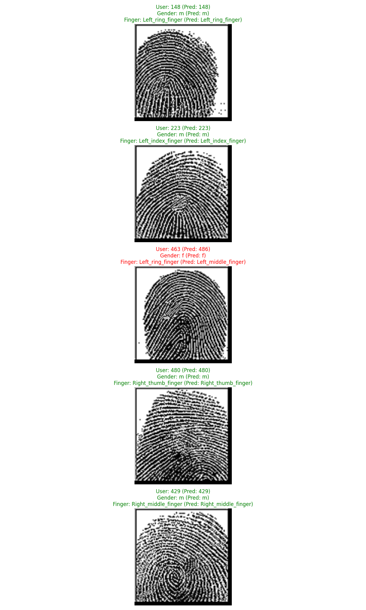

# Fingerprint Recognition and Gender Classification

A multi-task convolutional network that reads one fingerprint image and predicts three things at once: who the person is, whether they are male or female, and which finger the print came from.

The images and the trained weights are not in this repository. This repository contains the training notebook, the desktop app, and the results of the trained run.

## What is in this repository

| Path | Purpose |
|---|---|
| `model3.ipynb` | Loads the images, builds the network, trains it, and writes the metrics. |
| `final_code.py` | Desktop app. Upload a print, apply filters, then classify it. |
| `metrics/training_history.png` | Training and validation accuracy and loss for all three tasks. |
| `metrics/gender_confusion_matrix.png` | Gender results on the held-out test split. |
| `metrics/finger_confusion_matrix.png` | Finger results on the held-out test split. |
| `metrics/sample_predictions.png` | Five test images with the true label and the prediction. |
| `metrics/Detailed Metrics.pdf` | Full classification report from the same run. |
| `requirements.txt` | Python packages used to train and run the app. |

## Dataset

Training used the Sokoto Coventry Fingerprint Dataset (SOCOFing). It has 600 people, 477 male and 123 female, and ten fingers for each person. The images are not stored in this repository.

| Split | Images | What it contains |
|---|---:|---|
| Real prints | 6,000 | One image for every finger of every person. |
| Easy alterations | 17,931 | Up to three altered copies of each real print. |

A real file is named like `100__M_Left_index_finger.BMP`. An altered file adds the alteration at the end, for example `100__M_Left_index_finger_CR.BMP`. The three easy alterations are central rotation (`CR`), obliteration (`Obl`), and Z-cut (`Zcut`). The name encodes the person id, the gender (`M` or `F`), the hand, and the finger. Most images are 96×103 pixels.

Gender is uneven: 14,266 of the 17,931 altered images are male and 3,665 are female. The ten fingers are nearly even, about 1,785 to 1,800 images each.

## Preprocessing

Preprocessing was done in a separate step, before training, and that code is not in this repository. Each training image went through four filters, in this order:

1. **Contrast stretch**, using the 2nd and 98th percentile as the black and white points.
2. **Histogram equalization**, so ridge and background tones use the full range.
3. **Sharpen**, with the kernel `[[0, -1, 0], [-1, 5, -1], [0, -1, 0]]`.
4. **Segmentation** with Otsu's threshold.

The notebook does not repeat those filters. It opens each finished image, converts it to grayscale, resizes it to 128×128, drops a frame whose average brightness is below 10 or above 245, and scales pixels to the range 0–1.

During training only, the network also applies a small random rotation, a shift of up to 10%, a zoom of up to 10%, and a contrast change of up to 20%.

## How the data was split

The 17,931 preprocessed altered images were split by person id:

| Set | Images | Share |
|---|---:|---:|
| Train | 12,551 | 70% |
| Validation | 2,690 | 15% |
| Test | 2,690 | 15% |

The 6,000 real images were loaded as an external test, then left out of the final score. Their filenames have no alteration suffix, so the finger name parsed from those files did not match the ten finger names learned from the altered files. The numbers below are the internal test split.

## Model

The network takes a grayscale image of shape 128×128×1 and has three softmax outputs: 600 people, 2 genders, and 10 fingers.

- Block 1: 32 filters, 3×3, batch normalization, ReLU, max pooling.
- Block 2: two 64-filter convolutions with a 1×1 residual connection, then pooling.
- Block 3: the same pattern with 128 filters.
- Block 4: 256 filters, then pooling. The map is 8×8×256.
- Global average pooling is concatenated with the flattened map.
- Dense layer of 512 units, dropout 0.5, dense layer of 256 units, dropout 0.3.
- A separate dense layer for each task, then the softmax output.

The loss is sparse categorical cross-entropy. Person identity has weight 1.0. Gender and finger each have weight 0.5. The optimizer is Adam, starting at learning rate 0.001, with batch size 32. Training was allowed 100 epochs. It stopped early if validation loss did not improve for 10 epochs, and the learning rate was halved after 5 epochs without improvement. The run lasted 84 epochs. The best validation loss was at epoch 74, and those weights were restored for the test numbers below. The network has about 9.53 million parameters.

## Results

Scores are on the 2,690-image test split, using the weights from epoch 74.

| Task | Accuracy | Precision | Recall | F1 |
|---|---:|---:|---:|---:|
| Person | 84% | 88% | 84% | 84% |
| Gender | 88% | 84% | 75% | 78% |
| Finger | 80% | 80% | 80% | 80% |

Person precision, recall, and F1 are macro averages across 600 people. Gender precision, recall, and F1 are macro averages across the two classes. Top-5 person accuracy on this test split was 93.1%. At the best epoch, validation accuracy was 86.3% for the person, 87.6% for gender, and 80.1% for the finger. Top-5 person accuracy on validation was 94.7%.

### Gender

Male is the majority class, so a model that always answers male scores about 80% on this split. The trained model reaches 88%.

| Class | Precision | Recall | F1 | Images |
|---|---:|---:|---:|---:|
| Female | 0.78 | 0.54 | 0.64 | 548 |
| Male | 0.89 | 0.96 | 0.93 | 2,142 |

Female prints are the harder class: a little over half of them are recovered. Male recall is 96%.



### Finger

Thumbs are the easiest. Left thumb recall is 0.99 and right thumb recall is 0.94. Middle and ring fingers on the same hand are the usual confusions. Left and right are rarely swapped.

| Finger | Precision | Recall | F1 | Images |
|---|---:|---:|---:|---:|
| Left index | 0.79 | 0.81 | 0.80 | 273 |
| Left little | 0.72 | 0.76 | 0.74 | 263 |
| Left middle | 0.76 | 0.71 | 0.73 | 272 |
| Left ring | 0.71 | 0.68 | 0.70 | 283 |
| Left thumb | 0.91 | 0.99 | 0.95 | 282 |
| Right index | 0.86 | 0.79 | 0.83 | 263 |
| Right little | 0.77 | 0.79 | 0.78 | 278 |
| Right middle | 0.77 | 0.76 | 0.77 | 272 |
| Right ring | 0.73 | 0.75 | 0.74 | 252 |
| Right thumb | 0.96 | 0.94 | 0.95 | 252 |



### Training curves

Person accuracy climbs from about 0 to the mid-80s and is the task with the largest gap between training and validation. Gender starts near the male majority rate and ends in the high 80s. Finger accuracy rises from about 30% to about 80%.



### Sample predictions

Five images from the test split. Green means the person, the gender, and the finger were all correct. In this sample, four prints are fully correct. One print keeps the right gender and mistakes both the person and the finger.



## Setup

```bash
python3 -m venv .venv
source .venv/bin/activate
pip install -r requirements.txt
```

## Run the app

From this folder:

```bash
python final_code.py
```

The app can apply contrast stretch, histogram equalization, negative, sharpen, Laplacian, gamma correction, segmentation, CLAHE, a Gabor filter, a multi-orientation Gabor filter, and a fingerprint pipeline of blur, histogram equalization, and Canny-style edges. It can also add or subtract the filtered image from the original.

**Test Fingerprint Model** looks for `model/fingerprint_model_final_20250509_1311.h5` next to the script. That file is not in this repository. Train with the notebook, put the saved weights on that path, and then classify. The filters still run without the weights. The app resizes the filtered image to 128×128 and scales it to 0–1 before prediction, then shows the person, the gender, and the finger with a confidence for each.

## Train again

At the start of `main()` in `model3.ipynb`, set the two folders to the preprocessed training images and the real images on your machine:

```python
train_folder = r'/path/to/preprocessed-train-images'
test_folder = r'/path/to/real-images'
```

Run the notebook from this folder. It saves a new weights file named `fingerprint_model_final_<date>_<time>.h5`, plus the history plot, the confusion matrices, and the sample predictions.
